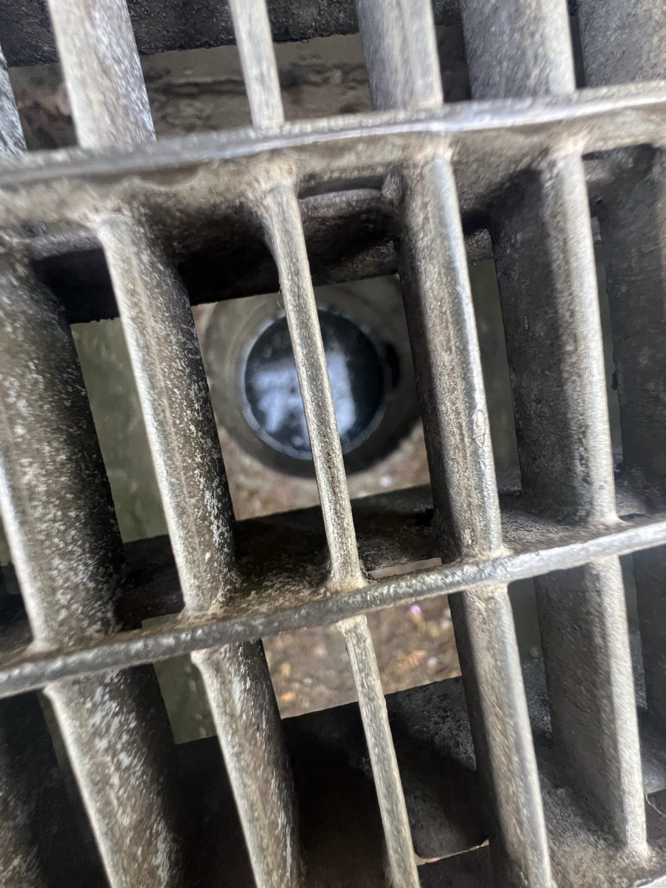

# Starkregen: Risikoanalyse vor Ort

**Gefahr aus der Karte, Verwundbarkeit von der Straße: ein Werkzeug, um das Überflutungsrisiko eines Objekts zu bewerten, und zwar Eintrittsstelle für Eintrittsstelle.**

Geeignet für alles, wo Wasser von außen eindringen kann:
- Tiefgaragen und Unterführungen
- U-Bahn- und Bahnhofszugänge
- Kellereingänge und Lichtschächte
- Untergeschosse von Krankenhäusern, Pflegeheimen oder Verwaltungsgebäuden
- Trafostationen und Pumpwerke

Starkregengefahrenkarten zeigen, wo sich Wasser sammelt. Ob es in ein Bauwerk läuft, entscheiden Schwellen, Einläufe, Gefälle und deren Zustand. Die stehen in keiner Karte. Dieses Verfahren erhebt beides getrennt und führt es in einer Risikomatrix zusammen.

## Die Idee: ein anderer Risikobegriff

Üblich ist *Risiko = Eintrittswahrscheinlichkeit × Schadensausmaß*. Für ein einzelnes Objekt hilft das wenig: Die Wahrscheinlichkeit eines Starkregens ist für alle Eingänge eines Gebäudes gleich, der Unterschied liegt im Detail vor Ort. Darum gilt hier:

> **Risiko = f(Gefahr, Verwundbarkeit)**

Die **Gefahr** kommt aus der Gefahrenkarte (wie hoch steht das Wasser an der Eintrittsstelle?), die **Verwundbarkeit** aus einer Begehung (was hält die Eintrittsstelle aus?). Erst beides zusammen zeigt, wo der **Kipppunkt** liegt, ab dem das Risiko sprunghaft steigt.

## Was man braucht

- eine Starkregengefahrenkarte, z. B. die bundesweite *Hinweiskarte Starkregengefahren* des BKG, eine Landeskarte oder eine kommunale Starkregengefahrenkarte
- QGIS oder den Kartendienst der Karte, um Wasserstände an Punkten abzulesen
- Zollstock, Kamera und den Erfassungsbogen aus der Excel
- das Werkzeug: [`werkzeug/starkregen_vor_ort.xlsx`](werkzeug/starkregen_vor_ort.xlsx) (Excel ab 2010, keine Makros). Gelbe Felder sind Eingaben, graue werden berechnet.

## Schritt für Schritt

### Schritt 1: Objekt und Szenario festlegen · Blatt *1 Objekt und Szenario*

Das Objekt beschreiben und das Szenario nach dem Schema des BBK-Leitfadens *Risikoanalyse im Bevölkerungsschutz* festlegen: Ereignis, Ort und Ausdehnung, Intensität, Zeitpunkt und Dauer, Verlauf, Vorwarnzeit, Referenzereignisse. Außerdem werden zwei Gefahrenszenarien aus der Karte benannt, z. B. *außergewöhnlich* (etwa 100-jährlich) und *extrem*.

### Schritt 2: Gefahr aus der Karte · Blatt *2 Gefahr*

1. **Eintrittsstellen festlegen:** Jede Öffnung, über die Wasser eindringen kann, bekommt eine ID (E1, E2 …). Das sind zum Beispiel Treppen, Rampen, Türen, Lichtschächte, Einfahrten und Aufzüge.
2. **Messpunkt setzen:** dort, wo das Wasser eintreten würde, also an der obersten Treppenstufe, an der Kante der Einfahrt oder an der Türschwelle.
3. **Wasserstand ablesen** für beide Szenarien. Maßgebend ist der höhere Wert, daraus ergibt sich die Gefahrenstufe:

| Wasserstand | Gefahrenstufe |
|---|---|
| unter 10 cm | gering |
| 10 bis 30 cm | mittel |
| über 30 cm | hoch |

*Tipp:* Bei mehreren Objekten derselben Art (z. B. alle Tiefgaragen eines Quartiers) zuerst alle grob über die Karte prüfen und dann das mit den höchsten Wasserständen begehen.

### Schritt 3: Begehung · Blatt *Erfassungsbogen* und Blatt *3 Begehung*

Den Erfassungsbogen ausdrucken und je Eintrittsstelle einmal ausfüllen. Dazu Fotos machen: Übersicht, Schwelle und Einlauf, Umfeld, Technik. Danach die Werte ins Blatt *3 Begehung* übertragen.

Alle Faktoren werden auf **1 (günstig) bis 5 (ungünstig)** eingeschätzt, nach dem Vorgehen des OECD-Handbuchs für zusammengesetzte Indikatoren:

| Kategorie | Faktor | 1 | 5 |
|---|---|---|---|
| **Bauliche Struktur** | Schwellenhöhe | ≥ 15 cm (dazwischen: < 15 → 2, < 10 → 3, < 5 → 4) | keine Schwelle |
| | Gefälle zur Öffnung | Gelände steigt zur Öffnung an | starkes Gefälle zur Öffnung |
| | Direktschutz | komplett überdacht oder geschlossen | offen |
| **Entwässerung** | Einlauf/Rinne vor der Öffnung | frei | verstopft oder keiner vorhanden |
| **Umfeld** | Mikrotopografie | Bordsteine/Gelände leiten Wasser ab | leiten Wasser hin |
| | Versiegelung (5 m) | Grünfläche | vollständig versiegelt |
| | Einläufe im Umfeld (20 m) | frei | verstopft |
| | Baustellen (20 m) | keine | großflächig geöffnet |
| **Schutzziel Mensch** | Entfluchtung | sicherer, erhöhter Vorplatz | direkt in den Straßenverkehr |
| | Warnung | redundante Warnsysteme | keine |
| **Technik im Inneren** | Energie, IT/Kommunikation, Förder- und Gebäudetechnik | nicht vorhanden | vorhanden und exponiert (geschützt = 3) |

Die Schwellenhöhe wird in cm eingetragen und automatisch umgerechnet. Das Puffervolumen von Schacht oder Rinne wird nur dokumentiert.

### Schritt 4: Regeln prüfen · Blatt *4 Regeln*

Alle Stellschrauben stehen an einem Ort und lassen sich anpassen:

- **Gewichte:** Entwässerung 40 %, bauliche Struktur 20 %, Umfeld 20 %, Schutzziel Mensch 10 %, Technik im Inneren 10 %. Ein Kontrollfeld prüft, dass die Summe 100 % ergibt. Die Entwässerung zählt am meisten, weil ein verstopfter Einlauf das System kippen lässt.
- **Schwellenwerte** für Schwellenhöhe, Gefahrenstufe und Verwundbarkeitsstufe (Index bis 2 gering, bis 4 mittel, darüber hoch)
- **Risikomatrix:**

| Gefahr ↓ · Verwundbarkeit → | gering | mittel | hoch |
|---|---|---|---|
| **hoch** | niedrig | mittel | **hoch** |
| **mittel** | kein | niedrig | mittel |
| **gering** | kein | kein | niedrig |

### Schritt 5: Ergebnis ablesen · Blatt *5 Ergebnis*

Je Eintrittsstelle berechnet die Excel:
- den **Mittelwert je Kategorie** und den gewichteten **Verwundbarkeitsindex** (1 bis 5) mit der Verwundbarkeitsstufe
- das **Risiko im Normalzustand** aus der Matrix
- das **Risiko bei Versagen:** Was passiert, wenn der Schutz ausfällt, etwa weil Laub den Einlauf verstopft? Dann gilt die Spalte „Verwundbarkeit hoch“.
- den **Kipppunkt:** Wo das Risiko dabei springt, hängt die Sicherheit am Zustand des Schutzes

Für das ganze Objekt gibt es den mittleren Index und eine Übersicht, wie viele Eintrittsstellen in welche Risikostufe fallen.

**Was man daraus ableitet:** Eintrittsstellen mit hoher Gefahr und Kipppunkt zuerst. Wo die Entwässerung den Ausschlag gibt, hilft oft schon eine regelmäßige Reinigung der Einläufe vor der Starkregensaison.

## Beispiel: U-Bahn-Haltestelle Steinstraße/Königsallee, Düsseldorf

Die Datei [`beispiel/beispiel_u-bahn_steinstrasse.xlsx`](beispiel/beispiel_u-bahn_steinstrasse.xlsx) enthält eine vollständige Anwendung mit 9 Zugängen, begangen am 11. April 2026. Die Station war bei einem stadtweiten Screening der U-Bahn-Zugänge die mit den höchsten Wasserständen.

| Zugang T6 | Einlaufgitter an T6 |
|---|---|
|  |  |

| Zugang | Wasserstand | Gefahr | Index | Risiko | bei Versagen |
|---|---|---|---|---|---|
| T1 Treppe | 40 cm | hoch | 2,18 | mittel | **hoch** |
| T2 Rolltreppe | 27 cm | mittel | 2,08 | niedrig | mittel |
| T6 Treppe | 29 cm | mittel | 2,77 | niedrig | mittel |
| T8 Rolltreppe | 25 cm | mittel | 2,95 | niedrig | mittel |
| T3 Rolltreppe | 13 cm | mittel | 2,43 | niedrig | mittel |
| A1 Aufzug, T4, T5, T7 | 0–8 cm | gering | 2,23–2,90 | kein | niedrig |
| **Station** | | | **2,50 (mittel)** | | |

Solange die Einläufe frei sind, hält die Station. Verstopfen sie, springt jeder Zugang eine Stufe höher, und T1 kommt mit 40 cm Wasser ins Feld „hoch“. Zum Vergleich: Ab etwa 0,35 m Wassertiefe bei 0,5 m/s Fließgeschwindigkeit kann ein Kind den Halt verlieren. Beim Aufzug A1 zeigt die Karte 0 cm, obwohl die Straße daneben überflutet ist. Das ist vermutlich ein Artefakt des Rasters, und deshalb gehört die Begehung dazu.

## Grenzen

- Gefahrenkarten im 1-m-Raster glätten: Schwellen und Einläufe fehlen. Manche Karten rechnen ohne Kanalnetz und sind damit bewusst ungünstig.
- Die Begehung ist eine Momentaufnahme. Laub und Wartung ändern den Zustand der Einläufe von Woche zu Woche.
- Die Einschätzungen von 1 bis 5 sind subjektiv. Fotos sichern sie ab, besser ist eine zweite Person, die unabhängig bewertet.
- Gewichte und Schwellenwerte sind begründet, aber nicht empirisch hergeleitet. Es lohnt sich zu prüfen, ob sich die Reihenfolge der Eintrittsstellen bei anderen Gewichten ändert.
- Was im Inneren passiert (Pumpen, Volumen, Ausbreitung), bildet das Verfahren nicht ab. Dafür braucht es Daten des Betreibers.

## Herkunft

Methode von Hendrik Platz und Tom Thum, entwickelt in einer Arbeit im Modul Naturgefahren und -risiken (Prof. Dr. Alexander Fekete), Institut für Rettungsingenieurwesen und Gefahrenabwehr, TH Köln, 2026. Die ursprüngliche Anwendung: [Steckbrief in RIW-Projekte](https://github.com/2708Tom/RIW-Projekte/tree/main/2026-07_NGR_Starkregen-U-Bahn).

Daten im Beispiel: Hinweiskarte Starkregengefahren © BKG; Starkregengefahrenkarte NRW, Geobasis NRW; © OpenStreetMap-Mitwirkende.
