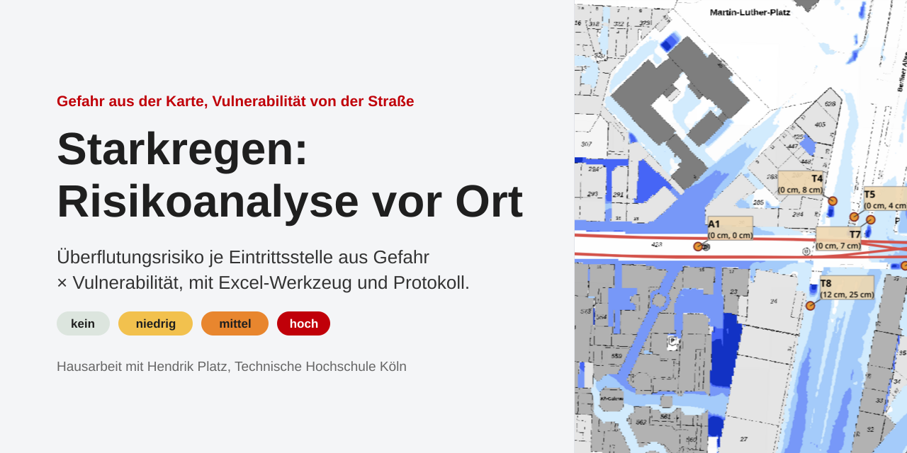
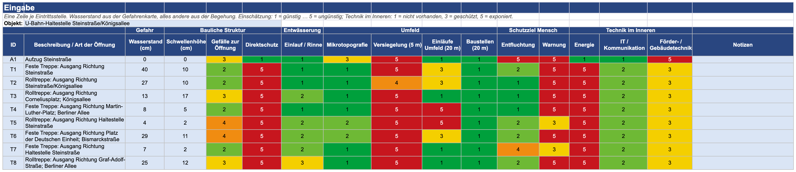
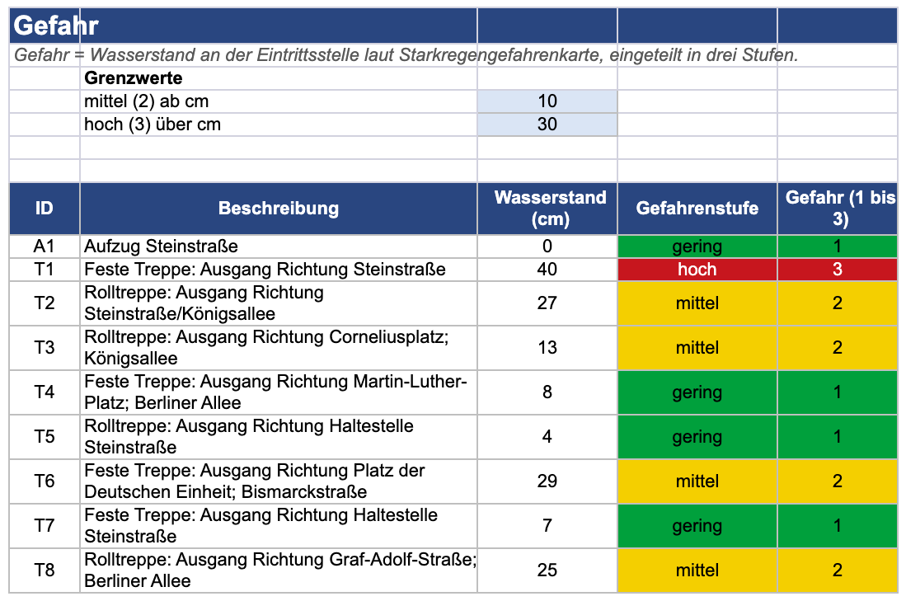
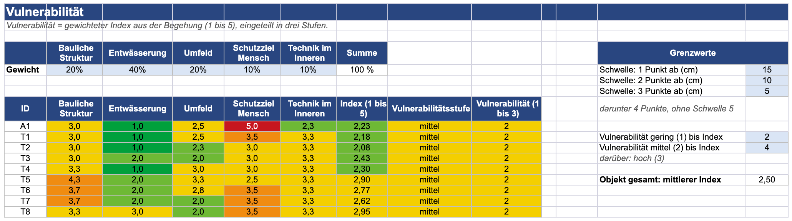
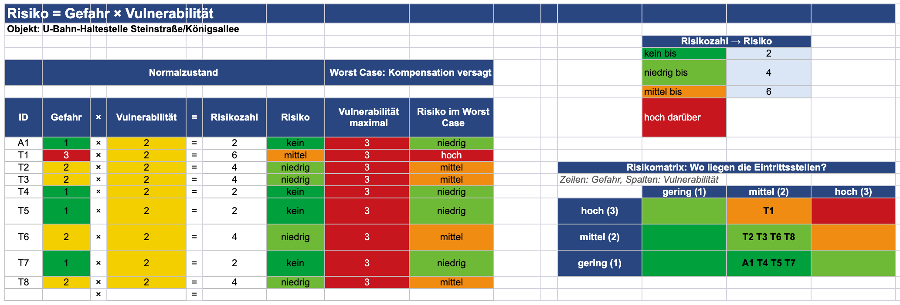

**Gefahr aus der Karte, Vulnerabilität von der Straße: ein Werkzeug, um das Überflutungsrisiko eines Objekts zu bewerten, und zwar Eintrittsstelle für Eintrittsstelle.**

Geeignet für alles, wo Wasser von außen eindringen kann: Tiefgaragen, Unterführungen, U-Bahn-Zugänge, Kellereingänge, Lichtschächte, Untergeschosse von Krankenhäusern oder Pflegeheimen, Trafostationen.

## Die Idee

Starkregengefahrenkarten zeigen, wo sich Wasser sammelt. Ob es in ein Bauwerk läuft, entscheiden Schwellen, Einläufe, Gefälle und deren Zustand, und die stehen in keiner Karte. Darum gilt hier:

> **Risiko = Gefahr × Vulnerabilität**

Die **Gefahr** ist der Wasserstand an der Eintrittsstelle laut Karte. Die **Vulnerabilität** kommt aus einer Begehung. Beide werden in drei Stufen (1 bis 3) eingeteilt, ihr Produkt ist die Risikozahl (1 bis 9).

### Warum nicht Eintrittswahrscheinlichkeit mal Schadenshöhe?

Der klassische Risikobegriff hilft bei einem einzelnen Objekt wenig:

- **Die Wahrscheinlichkeit unterscheidet nichts.** Ein Starkregen trifft alle Eintrittsstellen eines Gebäudes gleich wahrscheinlich. Ob Wasser eindringt, entscheidet sich am baulichen Detail jeder einzelnen Öffnung.
- **Belastbare Wahrscheinlichkeiten fehlen.** Starkregengefahrenkarten rechnen Szenarien (außergewöhnlich, extrem), aber keine Wahrscheinlichkeit dafür, dass an einer bestimmten Treppe Wasser eindringt. Lokale Extremregen sind kaum vorherzusagen.
- **Die Schadenshöhe ist vor Ort nicht zu beziffern.** Was hinter einer Öffnung passiert (Pumpen, Technik, Personen), wissen nur die Betreiber. Ohne deren Daten wäre jede Zahl geschätzt.
- **Die Vulnerabilität lässt sich beeinflussen.** Einläufe reinigen, Schwellen erhöhen, Technik hochlegen: Ein Ansatz über die Vulnerabilität zeigt direkt, wo Maßnahmen wirken.

## Was man braucht

- eine Starkregengefahrenkarte, z. B. die bundesweite *Hinweiskarte Starkregengefahren* des BKG oder eine kommunale Karte
- das [Erfassungsprotokoll](werkzeug/erfassungsprotokoll.docx) (Word), Zollstock und Kamera
- die Excel [`werkzeug/starkregen_vor_ort.xlsx`](werkzeug/starkregen_vor_ort.xlsx) mit den Blättern *Anleitung*, *Eingabe*, *Gefahr*, *Vulnerabilität* und *Risiko*. Hellblaue Felder sind Eingaben, weiße werden berechnet. Die Farben folgen der DIN EN ISO 22324 für farbcodierte Alarme.

## So geht es

**1. Eintrittsstellen festlegen.** Jede Öffnung, über die Wasser eindringen kann, bekommt eine ID: Treppe, Rampe, Tür, Lichtschacht, Einfahrt, Aufzug.

**2. Gefahr ablesen.** An jeder Eintrittsstelle den Wasserstand aus der Karte ablesen, und zwar dort, wo Wasser eintreten würde (oberste Stufe, Kante der Einfahrt).

**3. Begehen.** Je Eintrittsstelle ein Erfassungsprotokoll ausfüllen und Fotos machen. Alles wird von 1 (günstig) bis 5 (ungünstig) eingeschätzt:

| Kategorie (Gewicht) | Faktoren | 1 | 5 |
|---|---|---|---|
| **Bauliche Struktur** (20 %) | Schwellenhöhe | ≥ 15 cm | keine Schwelle |
| | Gefälle zur Öffnung | steigt zur Öffnung an | starkes Gefälle zur Öffnung |
| | Direktschutz | überdacht oder geschlossen | offen |
| **Entwässerung** (40 %) | Einlauf/Rinne vor der Öffnung | frei | verstopft oder keiner vorhanden |
| **Umfeld** (20 %) | Mikrotopografie, Versiegelung (5 m), Einläufe (20 m), Baustellen (20 m) | leitet ab, grün, frei, keine | leitet hin, versiegelt, verstopft, großflächig |
| **Schutzziel Mensch** (10 %) | Entfluchtung, Warnung | sicherer Vorplatz, redundante Warnung | Straßenverkehr, keine Warnung |
| **Technik im Inneren** (10 %) | Energie, IT/Kommunikation, Förder-/Gebäudetechnik | nicht vorhanden | exponiert (geschützt = 3) |

Die Entwässerung zählt am meisten, weil ein verstopfter Einlauf das System kippen lässt.

**4. Eintragen.** Im Blatt *Eingabe* eine Zeile je Eintrittsstelle. Das Protokoll nennt bei jedem Feld die passende Spalte (→ A, → B …).

**5. Auswerten.** Die Excel rechnet in drei Blättern, jedes mit seinen Grenzwerten oben:

| Blatt | Was passiert | Ergebnis |
|---|---|---|
| *Gefahr* | Wasserstand einteilen: unter 10 cm, 10 bis 30 cm, über 30 cm | Gefahr 1, 2 oder 3 |
| *Vulnerabilität* | Mittelwert je Kategorie, gewichtet zum Index (1 bis 5), einteilen: bis 2, bis 4, darüber | Vulnerabilität 1, 2 oder 3 |
| *Risiko* | **Gefahr × Vulnerabilität** | Risikozahl 1 bis 9: bis 2 kein, bis 4 niedrig, bis 6 mittel, 9 hoch |

Das Blatt *Gefahr* teilt die Wasserstände ein:

Das Blatt *Vulnerabilität* bildet aus der Begehung den gewichteten Index. Gewichte und Grenzwerte stehen oben und lassen sich anpassen:

Das Blatt *Risiko* multipliziert beides und zeigt die Risikomatrix. In jedem Feld stehen die IDs der Eintrittsstellen, die Farbe zeigt das Risiko:

Zusätzlich zeigt die Excel das Risiko im Worst Case. Schwellen, Einläufe und Rinnen sind Kompensationsmaßnahmen und halten Wasser nur bis zu einem gewissen Punkt zurück. Wirken sie nicht mehr, etwa bei extremer Regenmenge oder zugesetztem Gitter, ist die Vulnerabilität maximal. Oft hilft schon eine regelmäßige Reinigung der Einläufe vor der Starkregensaison.

## Beispiel: U-Bahn-Haltestelle Steinstraße/Königsallee, Düsseldorf

[`beispiel/beispiel_u-bahn_steinstrasse.xlsx`](beispiel/beispiel_u-bahn_steinstrasse.xlsx): 9 Zugänge, begangen am 11. April 2026, Wasserstände aus dem Szenario „extrem“.

| Zugang T6 | Einlaufgitter an T6 |
|---|---|
|  |  |

Risikomatrix der Station (mittlerer Index 2,50, alle Zugänge mit mittlerer Vulnerabilität):

| Gefahr (Zeilen), Vulnerabilität (Spalten) | gering (1) | mittel (2)     | hoch (3) |
| ----------------------------------------- | ---------- | -------------- | -------- |
| **hoch**                                  |            | **T1** (40 cm) |          |
| **mittel**                                |            | T2, T3, T6, T8 |          |
| **gering**                                |            | A1, T4, T5, T7 |          |

Solange Gitter und Schwellen wirken, hält die Station. Versagen sie, ist die Vulnerabilität maximal, jeder Zugang steigt eine Stufe, und T1 landet im roten Feld. Zum Vergleich: Ab etwa 0,35 m Wassertiefe bei 0,5 m/s kann ein Kind den Halt verlieren. Beim Aufzug A1 zeigt die Karte 0 cm, obwohl die Straße daneben überflutet ist. Das ist vermutlich ein Artefakt des Rasters, und deshalb gehört die Begehung dazu.

## Grenzen

- Gefahrenkarten im 1-m-Raster glätten: Schwellen und Einläufe fehlen. Manche Karten rechnen ohne Kanalnetz und sind damit bewusst ungünstig.
- Die Begehung ist eine Momentaufnahme. Laub und Wartung ändern den Zustand der Einläufe ständig.
- Die Einschätzungen sind subjektiv. Fotos und eine zweite Person, die unabhängig bewertet, sichern sie ab.
- Gewichte und Grenzwerte sind begründet, aber nicht empirisch hergeleitet.

## Herkunft

Methode von Hendrik Platz und Tom Thum, entwickelt im Modul Naturgefahren und -risiken (Prof. Dr. Alexander Fekete), Institut für Rettungsingenieurwesen und Gefahrenabwehr, TH Köln, 2026. Die Hausarbeit liegt als PDF bei: [`hausarbeit/hausarbeit_starkregen_u-bahn.pdf`](hausarbeit/hausarbeit_starkregen_u-bahn.pdf).

Daten im Beispiel: Hinweiskarte Starkregengefahren © BKG; Starkregengefahrenkarte NRW, Geobasis NRW; © OpenStreetMap-Mitwirkende.

## Quellen und Links

- BBK: [Risikoanalyse im Bevölkerungsschutz. Ein Stresstest für die Allgemeine Gefahrenabwehr und den Katastrophenschutz](https://www.bbk.bund.de/SharedDocs/Downloads/DE/Mediathek/Publikationen/PiB/PiB-16-risikoanalyse-bevoelkerungsschutz.pdf?__blob=publicationFile&v=9), Praxis im Bevölkerungsschutz Band 16, Schema für die Szenariobeschreibung
- BKG: [Hinweiskarte Starkregengefahren, Fragen und Antworten](https://sg.geodatenzentrum.de/web_public/gdz/dokumentation/deu/hwk_srg_FAQ.pdf), Datengrundlage für die Gefahr
- OECD und JRC: [Handbook on Constructing Composite Indicators. Methodology and User Guide](https://publications.jrc.ec.europa.eu/repository/handle/JRC47008) (2008), Vorgehen für den Vulnerabilitätsindex
- [DIN EN ISO 22324:2025-08](https://www.dinmedia.de/en/standard/din-en-iso-22324/391925246) Sicherheit und Resilienz, Gefahrenabwehr, Leitfaden für farbcodierte Alarme, Farbwerte nach Anhang B
- Hausarbeit: [Risikoanalyse pluvialer Überflutungen an urbanen U-Bahn-Systemen](hausarbeit/hausarbeit_starkregen_u-bahn.pdf) (PDF)
