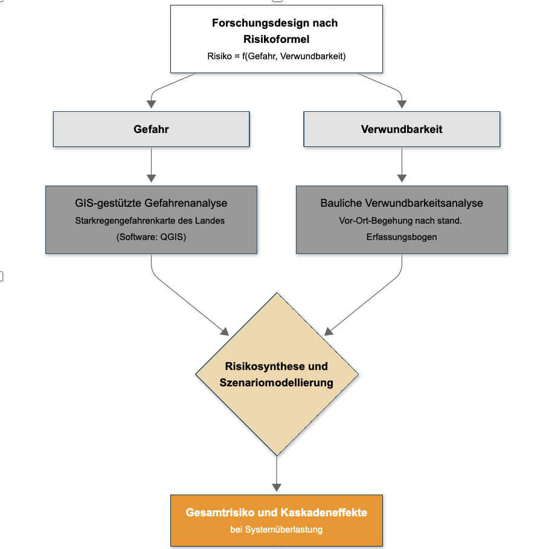
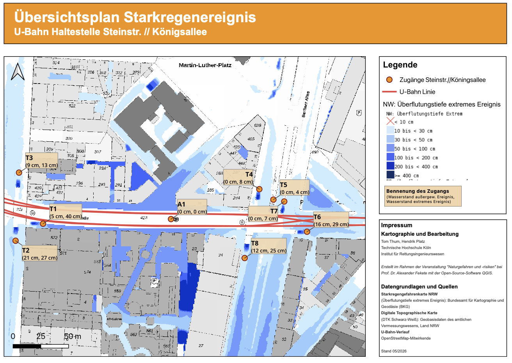
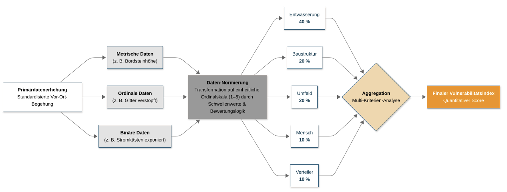
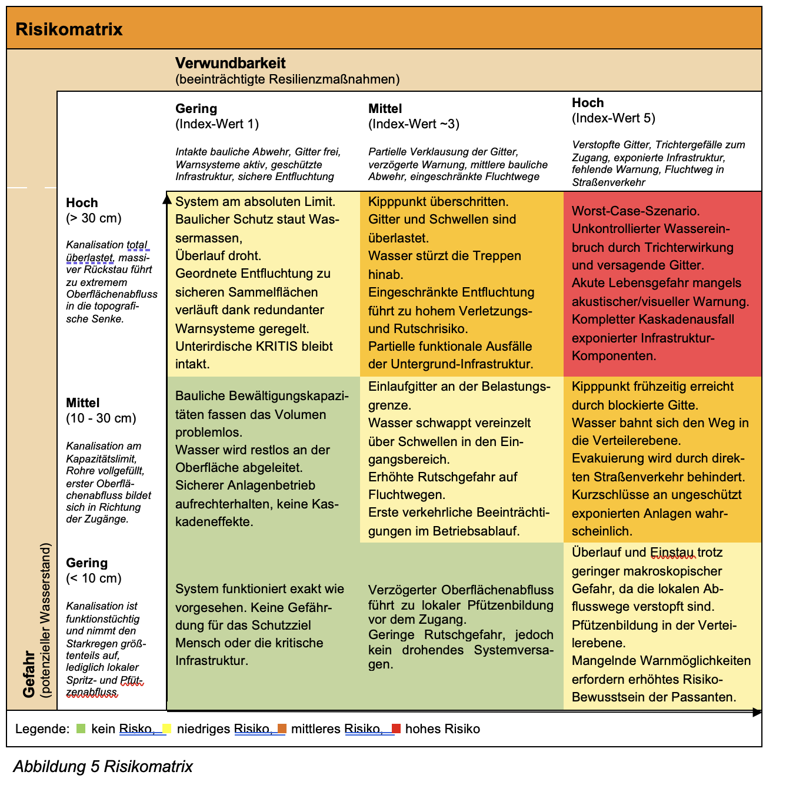

# Starkregen: Risikoanalyse vor Ort

**Gefahr aus der Karte, Verwundbarkeit von der Straße: ein Verfahren, um das Überflutungsrisiko eines einzelnen Objekts zu bewerten, etwa eines U-Bahn-Zugangs, einer Tiefgarage oder eines Kellereingangs.**

Starkregengefahrenkarten zeigen, wo sich Wasser sammelt. Ob es dann in ein Bauwerk läuft, entscheiden Bordsteine, Einlaufgitter und deren Zustand, und die stehen in keiner Karte. Dieses Verfahren erhebt beides getrennt und führt es dann in einer Risikomatrix zusammen.

## Die Idee: ein anderer Risikobegriff

Üblich ist *Risiko = Eintrittswahrscheinlichkeit × Schadensausmaß*. Für ein einzelnes Bauwerk sagt das wenig: Die Wahrscheinlichkeit eines Extremregens ist für alle Zugänge in einer Straße gleich, der Schaden hängt aber am Detail vor Ort. Darum gilt hier:

> **Risiko = f(Gefahr, Verwundbarkeit)**

Die **Gefahr** kommt aus der Gefahrenkarte (wie hoch steht das Wasser?), die **Verwundbarkeit** aus einer Begehung (was hält das Bauwerk aus?). Erst die Kombination zeigt, wo der **Kipppunkt** liegt, ab dem das Risiko sprunghaft steigt.

## Schritt für Schritt

### Schritt 1: Szenario festlegen

Das Szenario wird nach dem Schema des BBK-Leitfadens *Risikoanalyse im Bevölkerungsschutz* beschrieben: Ereignis, Ort und Ausdehnung, Intensität, Zeitpunkt und Dauer, Verlauf, Vorwarnzeit und Referenzereignisse. Beispiel: extremer Starkregen mit etwa 90 mm in einer Stunde plus einer Stunde Nachlauf, ohne nennenswerte Vorwarnzeit.

### Schritt 2: Gefahr aus der Karte (GIS)

1. In QGIS die *Hinweiskarte Starkregengefahren* (BKG) bzw. die Starkregengefahrenkarte NRW per WMS laden. Die Karte liegt im 1-m-Raster vor und rechnet ohne Kanalnetz, ist also bewusst ungünstig.
2. **Screening:** Alle Objekte der Art (z. B. alle U-Bahn-Zugänge einer Stadt) als Punkte anlegen und den Wasserstand auslesen. Das Objekt mit den höchsten Werten wird im Detail untersucht.
3. Am ausgewählten Objekt jeden Zugang als Punkt setzen, und zwar an der Stelle, an der das Wasser eintreten würde (z. B. oberste Treppenstufe).
4. Den Wasserstand je Zugang für zwei Szenarien auslesen: außergewöhnlich (etwa 100-jährlich) und extrem.

### Schritt 3: Begehung mit dem Erfassungsprotokoll

Mit dem [Erfassungsprotokoll](werkzeuge/erfassungsprotokoll.docx) wird jeder Zugang einzeln aufgenommen, dazu Übersichts- und Detailfotos.

| Zugang T6 | Einlaufgitter an T6 |
|---|---|
|  |  |

Das Protokoll erfasst drei Arten von Daten: Messwerte (Bordsteinhöhe in cm, Volumen des Schachts in m³), Einschätzungen auf einer Skala von 1 bis 5 und eine Bestandsaufnahme der Technik in der Station.

### Schritt 4: Alles auf eine Skala bringen

Jeder Faktor wird auf **1 (sehr geringe) bis 5 (kritische) Verwundbarkeit** übersetzt, nach dem Vorgehen des OECD-Handbuchs für zusammengesetzte Indikatoren:

| Kategorie | Faktor | 1 | 5 |
|---|---|---|---|
| **Bauliche Struktur** | Bordsteinhöhe | ≥ 15 cm (dazwischen: < 15 → 2, < 10 → 3, < 5 → 4) | 0 cm |
| | Gefälle | starke Steigung zum Zugang | starkes Gefälle zum Zugang |
| | Baulicher Direktschutz | komplett überdacht | offen |
| **Lokale Entwässerung** | Zustand Einlaufgitter | frei | verstopft |
| **Umfeld** | Mikrotopografie | Bordsteine leiten Wasser ab | Bordsteine leiten Wasser hin |
| | Versiegelung (5 m) | Grünfläche | versiegelt |
| | Straßeneinläufe (20 m) | frei | verstopft |
| | Baustellen (20 m) | keine | großflächig geöffnet |
| **Schutzziel Mensch** | Entfluchtung | sicherer Vorplatz | direkt in den Straßenverkehr |
| | Warnung | redundante Warnsysteme | keine |
| **Verteilerebene** | Energie, IT, Transport (z. B. Stromverteiler, Notrufsäulen, Aufzugsgrube) | nicht vorhanden | vorhanden und exponiert (geschützt = 3) |

Die Bordsteinhöhe rechnet die Excel automatisch um. Das Volumen des Schachts wird als Pufferkapazität mitgeführt, geht aber nicht in den Index ein.

### Schritt 5: Gewichten und den Index bilden

Je Kategorie wird der Mittelwert gebildet und dann gewichtet. Die Entwässerung zählt am meisten, weil ein verstopftes Gitter das ganze System kippen lässt:

| Entwässerung | Bauliche Struktur | Umfeld | Schutzziel Mensch | Verteilerebene |
|---|---|---|---|---|
| 40 % | 20 % | 20 % | 10 % | 10 % |

In der [Excel](werkzeuge/vulnerabilitaetsindex.xlsx) kommen die Rohwerte ins Blatt **Auswertung Vulnerab.**, die Gewichte stehen im Blatt **Dashboard** in Zeile 2. Ein Kontrollfeld prüft, dass die Gewichte zusammen 1 ergeben. Ergebnis ist der Index je Zugang und der Mittelwert für das Objekt:

| Index | Verwundbarkeit |
|---|---|
| 1 | sehr gering |
| über 1 bis 2 | gering |
| über 2 bis 3 | mittel |
| über 3 bis 4 | hoch |
| über 4 bis 5 | kritisch |

### Schritt 6: Risikomatrix

Gefahr und Verwundbarkeit werden in einer 3 × 3-Matrix zusammengeführt. Jedes Feld ist als kurzes Szenario beschrieben und nicht nur als Farbe.

- **Gefahr** nach Wasserstand am Zugang: gering < 10 cm, mittel 10–30 cm, hoch > 30 cm
- **Verwundbarkeit** nach Index: gering (um 1), mittel (um 3), hoch (um 5)

### Schritt 7: Kipppunkt und Worst Case

Ohne Daten der Betreiber (Pumpen, Kanalkapazität) lassen sich Wassermengen im Untergrund nicht seriös rechnen. Stattdessen wird gefragt: **Was passiert, wenn die Schutzmechanismen versagen?** Verstopfen die Gitter, verschiebt sich ein Zugang in der Matrix nach rechts. Wo dann eine hohe Gefahr auf hohe Verwundbarkeit trifft, liegt der Kipppunkt. Ab dort läuft das Wasser ungehindert in das Bauwerk.

## Beispiel: U-Bahn Steinstraße/Königsallee, Düsseldorf

Die Excel enthält die Werte dieser Begehung (9 Zugänge, 11. April 2026).

| Zugang | Wasserstand extrem | Index | Zugang | Wasserstand extrem | Index |
|---|---|---|---|---|---|
| A1 (Aufzug) | 0 cm* | 2,23 | T5 | 4 cm | 2,90 |
| T1 | **40 cm** | 2,18 | T6 | 29 cm | 2,77 |
| T2 | 27 cm | 2,08 | T7 | 7 cm | 2,62 |
| T3 | 13 cm | 2,43 | T8 | 25 cm | **2,95** |
| T4 | 8 cm | 2,30 | **Station** | | **2,50 (mittel)** |

\* Die Straße daneben ist überflutet, der Aufzug selbst nicht. Vermutlich ist das ein Artefakt des Rasters.

Solange die Gitter frei sind, liegt die Station im mittleren Bereich. Verstopfen sie, kippt T1 mit 40 cm Wasser ins rote Feld. Zum Vergleich: Ab etwa 0,35 m Wassertiefe bei 0,5 m/s kann ein Kind den Halt verlieren.

## Grenzen

- Das Raster der Karte glättet: Bordsteine und Gitter fehlen. Die Begehung gleicht das aus, ist aber eine Momentaufnahme, denn Laub und Wartung ändern den Zustand der Gitter.
- Die Einschätzungen von 1 bis 5 sind subjektiv. Fotos sichern sie ab, besser ist eine zweite Person, die unabhängig bewertet.
- Die Gewichte sind begründet, aber nicht empirisch hergeleitet. Es lohnt sich zu prüfen, ob sich die Reihenfolge der Zugänge bei anderen Gewichten ändert.
- Ohne Betreiberdaten bleibt der Verlauf im Untergrund eine Annahme.

## Herkunft

Entstanden in der Arbeit „Risikoanalyse pluvialer Überflutungen an urbanen U-Bahn-Systemen“ im Modul Naturgefahren und -risiken (Prof. Dr. Alexander Fekete), Institut für Rettungsingenieurwesen und Gefahrenabwehr, TH Köln, 2026, von Hendrik Platz und Tom Thum. Mehr zur Arbeit: [Steckbrief in RIW-Projekte](https://github.com/2708Tom/RIW-Projekte/tree/main/2026-07_NGR_Starkregen-U-Bahn).

**Korrektur gegenüber der Hausarbeit:** In der ursprünglichen Excel ging die Verteilerebene nicht in den Gesamtindex ein, obwohl sie mit 10 % gewichtet war. Das ist hier behoben. Der Index der Station steigt dadurch von 2,17 auf 2,50 und bleibt im Bereich „mittel“.

Daten: Hinweiskarte Starkregengefahren © BKG; Starkregengefahrenkarte NRW, Geobasis NRW; © OpenStreetMap-Mitwirkende.
